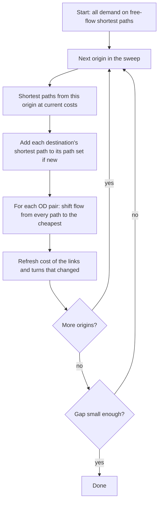

# How it works

## The problem

Travellers choose paths. Congestion makes a path slower the more people use it. In a **user
equilibrium** (Wardrop's first principle) every used path between a pair of zones has the same
cost, and no unused path is cheaper.

For link delays that depend only on the link's own volume, this is the minimiser of the Beckmann
objective

\[
\min \sum_a \int_0^{v_a} t_a(x)\,dx
\quad\text{subject to}\quad
\sum_{p \in P_{od}} f_p = q_{od},\; f_p \ge 0,
\]

where \(v_a\) is the volume on link \(a\), \(t_a\) its delay function, \(f_p\) the flow on path \(p\)
and \(q_{od}\) the demand of an OD pair. Turn delays enter the same way as extra "pseudo-links".

## Gradient projection

PyTA's main solver keeps, for every OD pair, a small set of paths and moves flow between them.

**The shift.** For a path \(p\) costing more than the cheapest path \(p^*\), the Newton step is

\[
\Delta = \min\!\left(f_p,\; \frac{c_p - c_{p^*}}{\sum_{a \in p \,\triangle\, p^*} t_a'(v_a)}\right),
\]

where the sum runs over the links and turns the two paths do *not* share. Shared links do not change
when flow moves between the paths, so they are left alone. Flow \(\Delta\) moves from \(p\) to \(p^*\).

**Gauss-Seidel.** After every single shift the costs of the touched links are refreshed, so the next
shift sees the effect of the last one. This matters: shifting several paths of one OD pair from a
single cost snapshot overshoots when they load the same links, and with strong turn delays it
stalled convergence ([decision record](../design/decisions/0003-gradient-projection.md)).

**Why paths.** Keeping paths gives path flows, select-link analysis and turn flows directly. The cost
is memory: zones² × paths per OD × links per path.

## Frank-Wolfe

Frank-Wolfe loads all demand on the current shortest paths, then moves the *link flows* part way
toward that target with an exact line search. It needs little memory and is simple, but it slows
down badly near the solution (Sioux Falls: 9 825 iterations for gap 1e-5, against 54 sweeps of gradient
projection for 1e-6). PyTA uses it as a reference to check gradient projection against.

## The relative gap

\[
\text{gap} = 1 - \frac{\sum_{od} q_{od}\, c^{\min}_{od}}{\sum_a v_a\, t_a(v_a)}
\]

the total cost if everybody took the cheapest path, divided by the total cost of the current flows.
It is zero at equilibrium. During a sweep PyTA tracks a cheap estimate; before declaring convergence
it recomputes the gap exactly from fresh shortest paths at one consistent set of costs.

## Parallel sweeps

Shifting flow must stay sequential (each shift sees the previous one's costs), but finding the shortest
paths does not. A sweep therefore handles origins in *chunks*: the searches of a chunk's origins run in
parallel, then the shifts are applied origin by origin. A path found with costs a few origins old is still
a valid candidate, and every shift prices its paths with current costs, so the method converges to the same
equilibrium. The default chunk is about 1/32 of the origins. See [the decision record](../design/decisions/0007-parallel-sweeps.md).

## Origin order

A sweep visits origins one at a time, so the order matters a little. PyTA offers `fixed`, `shuffle`,
`alternate`, `largest_gap`, `largest_demand` and `smallest_demand`. On the larger benchmarks shuffling or
largest-gap-first needed about 30% fewer sweeps; on small networks the differences are noise. See
[benchmarks](../benchmarks.md#origin-order).
