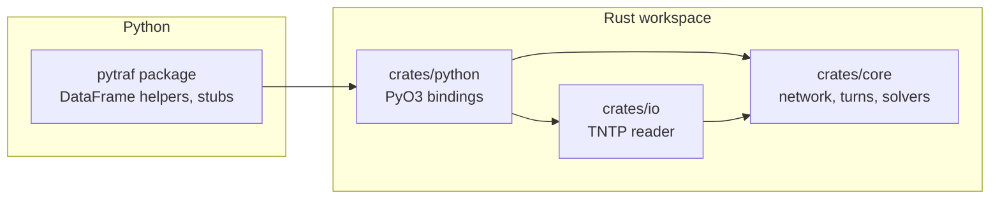

# Architecture

The core takes typed arrays and does no file IO, so Rust and Python users call the same code. File
formats live in `pytraf-io`; the bindings convert numpy arrays into core types and back.

## Modules of `pytraf-core`

| module | responsibility |
|---|---|
| `network` | immutable CSR graph with explicit dense link ids |
| `turns` | `TurnTable`: allowed turns in CSR form by incoming link, bans, penalties |
| `vdf` | delay functions (`Vdf` trait, `Bpr`, `NoDelay`) over arrays of links or turns |
| `shortest_path` | node-based `dijkstra`; turn-aware `dijkstra_turns` with link labels |
| `assignment` | `OdDemand`, all-or-nothing loading, shared `SolverError` |
| `frank_wolfe` | reference solver, with turn costs |
| `path_store` | per-origin tree of path steps; per-OD path sets |
| `order` | origin order for Gauss-Seidel sweeps |
| `gradient_projection` | the main solver, single and multi-class |

## Data layout

- **Structure of arrays.** Topology is fixed; costs and flows are separate `Vec<f64>` indexed by link
  id (or turn id), per class where needed. Nothing is mutated inside the graph.
- **Paths.** Each origin keeps a tree of steps (arrive on a link, coming from a parent step); a path is
  the step where it ends plus its flow, so paths that start alike share storage
  ([decision 0008](decisions/0008-path-tree.md)). An OD pair holds a few paths, found by comparing step ids.
- **Scratch space** for the symmetric difference of two paths uses stamped marker arrays that clear
  in constant time.

## One sweep, in code

1. Pick the origins in the configured order.
2. For each origin and class: one `dijkstra_turns` call with the class's costs.
3. For each OD pair of the class: add the shortest path if new, then shift flow among its paths
   ([details](../concepts/how-it-works.md)), refreshing touched costs after every shift.
4. After the sweep, rebuild link and turn volumes from path flows to remove rounding drift.
5. If the cheap gap estimate is small enough, confirm with an exact gap from fresh shortest paths.

## Testing strategy

Every solver result is checked against something independent of the code being tested: published
solutions (flows and objective), an expanded turn-free model, closed-form equilibria, and brute-force
reference implementations (Bellman-Ford for shortest paths). Rust tests run with `cargo test --workspace`,
Python tests with `pytest`.
