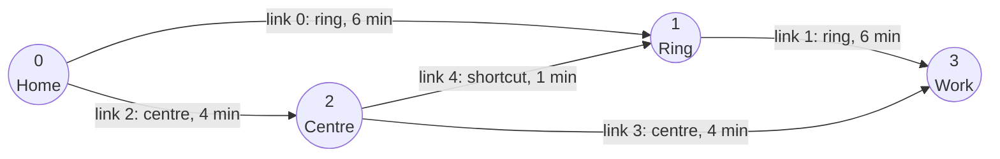

# Getting started

## Install

PyTA is not on PyPI yet. Download the wheel for your system from the
[latest release](https://github.com/harisbal/pyta/releases/latest) (Linux, macOS and Windows; Python 3.9
or newer) and install it:

```sh
pip install pyta-{{ version }}-<platform>.whl      # the file you downloaded
pip install pandas                                 # optional: for the DataFrame inputs and tables
```

### Build from source

You need [Rust](https://rustup.rs), Python 3.9 or newer, and [maturin](https://www.maturin.rs):

```sh
git clone https://github.com/harisbal/pyta pyta && cd pyta
uv venv .venv && source .venv/bin/activate        # or: python -m venv .venv
uv pip install numpy pandas maturin
maturin develop --release                          # compile and install `pyta`
```

To install into another environment without Rust there, build a wheel once and install it there:

```sh
maturin build --release --out dist                 # writes dist/pyta-{{ version }}-cp39-abi3-*.whl
pip install dist/pyta-{{ version }}-cp39-abi3-*.whl
```

The wheel targets the stable Python ABI (`abi3`), so a single wheel works on Python 3.9 and newer. It is
specific to the operating system and CPU it was built on.

## A small example

3 000 drivers travel from **Home** to **Work** in one hour. They can take the ring road, cut through the
town centre, or start through the centre and use a short link onto the ring road.



Describe the roads in one table and the trips in another. Nodes are numbered from 0, and each row of
the link table is a link, numbered in order.

```python
import pandas as pd
import pyta

links = pd.DataFrame({
    "from_node":      [0, 1, 0, 2, 2],
    "to_node":        [1, 3, 2, 3, 1],
    "free_flow_time": [6.0, 6.0, 4.0, 4.0, 1.0],   # minutes on an empty road
    "capacity":       [2000, 2000, 1500, 800, 1000],   # vehicles per hour
})
trips = pd.DataFrame({"origin": [0], "destination": [3], "flow": [3000.0]})

net = pyta.Network.from_tables(links)
demand = pyta.Demand.from_table(net, trips)

result = pyta.assign(net, demand)
print(result)
# AssignResult(converged=True, iterations=13, relative_gap=2.071e-7, classes=1)
```

## Reading the result

`link_table()` gives the result per link as a pandas DataFrame:

```python
result.link_table().round(2)
```

```text
      from_node  to_node     flow   volume   voc  time
link
0             0        1  1244.73  1244.73  0.62  6.14
1             1        3  1753.07  1753.07  0.88  6.53
2             0        2  1755.27  1755.27  1.17  5.13
3             2        3  1246.93  1246.93  1.56  7.54
4             2        1   508.33   508.33  0.51  1.01
```

`flow` counts vehicles, `volume` counts them in car units (the same here, with only cars), `voc` is
volume over capacity and `time` is the travel time in minutes.

PyTA keeps the routes themselves, so you can also see who goes where:

```python
result.path_table().round(2)
```

```text
      origin  destination     flow   time      links
path
0          0            3  1246.93  12.67     (2, 3)
1          0            3  1244.73  12.67     (0, 1)
2          0            3   508.33  12.67  (2, 4, 1)
```

The centre is the shortest route when the roads are empty, but its second link has little capacity, so
traffic spreads until all three routes take 12.67 minutes. This is the **user equilibrium** of
Wardrop's first principle: every route in use has the same travel time, and no driver can arrive
sooner by switching to another.

The same results are available as numpy arrays indexed by link id (`result.link_flow`,
`result.link_time`, ...), which are faster for large networks.

## Larger networks

Real networks come from files or larger tables, and the call stays the same. The repository includes
the Sioux Falls benchmark:

```python
net = pyta.Network.from_tntp("data/tntp/SiouxFalls/SiouxFalls_net.tntp")
demand = pyta.Demand.from_tntp(net, "data/tntp/SiouxFalls/SiouxFalls_trips.tntp")
result = pyta.assign(net, demand)
```

GMNS datasets work too; see the [Python guide](guide/python.md#from-a-gmns-dataset).

## Next steps

The [Python guide](guide/python.md) continues this example: ban a turn, add trucks, load the network
with buses and analyse who uses a link.
