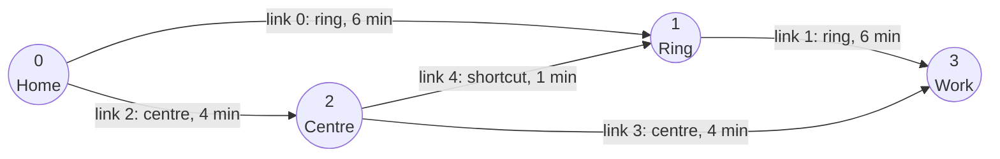

# Getting started

## Install

You need [Rust](https://rustup.rs), Python 3.9 or newer, and [maturin](https://www.maturin.rs).
PyTA is not on PyPI yet, so you build it from the repository:

```sh
git clone <repository> pyta && cd pyta
uv venv .venv && source .venv/bin/activate        # or: python -m venv .venv
uv pip install numpy pandas maturin
maturin develop --release                          # compile and install `pyta`
```

## A small example

3 000 drivers travel from **Home** to **Work** in one hour. They can take the ring road, cut through the
town centre, or start through the centre and use a short link onto the ring road.



Describe the roads in one table and the trips in another. Nodes are numbered from 0, and each row of
the link table is a link, numbered in order.

```python
import pandas as pd
import pyta

links = pd.DataFrame({
    "from_node":      [0, 1, 0, 2, 2],
    "to_node":        [1, 3, 2, 3, 1],
    "free_flow_time": [6.0, 6.0, 4.0, 4.0, 1.0],   # minutes on an empty road
    "capacity":       [2000, 2000, 1500, 800, 1000],   # vehicles per hour
})
trips = pd.DataFrame({"origin": [0], "destination": [3], "flow": [3000.0]})

net = pyta.network_from_tables(links)
demand = pyta.demand_from_table(trips, num_nodes=net.num_nodes)

result = pyta.assign(net, demand)
print(result)
# AssignResult(converged=True, iterations=13, relative_gap=2.071e-7, classes=1)
```

## Reading the result

How many vehicles use each link:

```python
result.link_flow.round()
# array([1245., 1753., 1755., 1247.,  508.])
```

The centre is the shortest route, but its second link has little capacity, so traffic spreads until
all three routes take the same time. That balance is the **user equilibrium**: nobody can arrive
sooner by switching route.

PyTA keeps the routes themselves, so you can see who goes where:

```python
paths = result.paths()
paths["flow"].round()                  # array([1247., 1245.,  508.])
paths["links"], paths["link_offsets"]  # links of path i: links[offsets[i]:offsets[i+1]]
```

| path | links | vehicles |
|---|---|---|
| through the centre | 2, 3 | 1 247 |
| ring road | 0, 1 | 1 245 |
| centre, then shortcut | 2, 4, 1 | 508 |

## Larger networks

Real networks come from files or larger tables, and the call stays the same. The repository includes
the Sioux Falls benchmark:

```python
net = pyta.Network.from_tntp("data/tntp/SiouxFalls/SiouxFalls_net.tntp")
demand = pyta.Demand.from_tntp("data/tntp/SiouxFalls/SiouxFalls_trips.tntp", net)
result = pyta.assign(net, demand)
```

GMNS datasets work too; see the [Python guide](guide/python.md#from-a-gmns-dataset).

## Next steps

The [Python guide](guide/python.md) continues this example: ban a turn, add trucks, run a morning and
an evening period.
